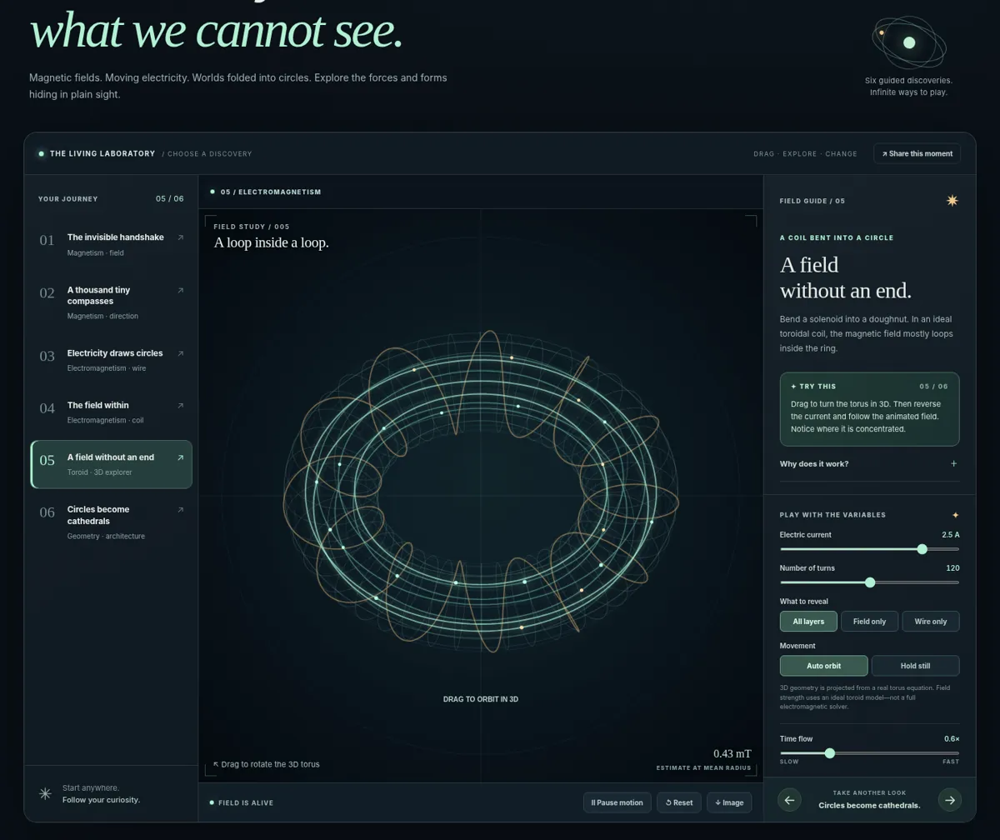

# ✳ MAGNETARIUM — The Invisible Museum

**Touch the invisible.** A responsive, open-source, interactive museum of magnetism, electromagnetism, toroidal coils, and architectural geometry.



## Six discoveries

| # | Exhibition | Explore |
|---|---|---|
| 01 | The invisible handshake | Move bar, disc, ring, and horseshoe magnets and examine their field patterns |
| 02 | A thousand tiny compasses | Watch field-aligned needles change direction when the magnet rotates |
| 03 | Electricity draws circles | Reverse current in a straight wire and see its circular magnetic field reverse |
| 04 | The field within | Change current and turn count in an idealised air-core solenoid |
| 05 | A field without an end | Rotate a fully parametric 3D toroidal coil; inspect wire windings and internal field loops |
| 06 | Circles become cathedrals | Generate rose windows, vault motifs, and geometric lattices with adjustable rotational symmetry |

Each exhibit offers a **one-sentence experiment**, optional **why-it-works** explanation, and *only the controls needed for that scene*. Pause motion, change time speed, save a PNG, or share a deep link preserving settings.

## Get started

Run a local server, without installing any JavaScript dependencies:

```bash
python -m http.server 8080
```

Open [http://localhost:8080](http://localhost:8080) in your browser.

Or open **`magnetarium-v4.1-standalone.html`** directly in any modern browser; it includes all HTML/CSS/JavaScript in one file and works offline. No API keys, subscriptions, or build step are needed.

## Tests and build

```bash
npm test
python build.py
```

- `src/physics.js` contains isolated, testable mathematical models.
- `src/render.js` draws the Canvas 2D field art, illustrated coils, and projected 3D torus.
- `src/app.js` manages the UI, controls, scene guide, and shareable URL state.
- `styles.css` defines the responsive museum layout.
- `tests/physics.test.mjs` checks field direction, idealised solenoid/toroid scaling, and torus geometry.
- `tests/browser_smoke.py` is an optional Playwright browser script used for visual checks during development.

## Models, honesty, and boundaries

The science is real, but this is not a laboratory-grade field solver:

- **Permanent magnets:** 2D softened fictitious-pole approximation. Field paths and interactions are illustrative; rigid-body collisions are simplified. A ring magnet is **not** the same as a toroidal solenoid.
- **Straight wire:** Ampère/Biot–Savart idealisation, with magnetic field `B = μ₀I/(2πr)` and right-hand direction. The drawing softens the near-wire singularity.
- **Solenoid:** ideal long air-core estimate `B ≈ μ₀(N/L)I`; no material or end-effect calculation. Coil turns are illustrated schematically rather than one-for-one.
- **Toroid:** ideal interior estimate `B ≈ μ₀NI/(2πr)`. Surface wire winding is shown as an actual 3D parametric curve. The glow traces illustrate field circulation; they are not particle trajectories.
- **Architectural geometry:** mathematical art. Rose windows, repeated arches and geometric motifs are meaningful historical and design forms, but pattern similarity alone does **not** establish special energy fields or health effects. “Sacred geometry” can be explored as symbolism, craft and mathematics without confusing it with electromagnetism.

### References

- [OpenStax — Magnetic Fields and Lines](https://openstax.org/books/university-physics-volume-2/pages/11-2-magnetic-fields-and-lines)
- [OpenStax — Solenoids and Toroids](https://openstax.org/books/university-physics-volume-2/pages/12-6-solenoids-and-toroids)
- [OpenStax — Key Equations](https://openstax.org/books/university-physics-volume-2/pages/12-key-equations)

## Dedicated GitHub repository

Source: **https://github.com/mikelninh/MAGNETARIUM**

To deploy this repository's own website, open **Settings → Pages**, choose **GitHub Actions** as the build source, and then re-run the `Test and deploy the museum` workflow if needed. Until that is configured, the existing [MAGNETARIUM portfolio edition](https://mikelninh.github.io/magnetarium/) remains available.

The static site requires no accounts, API keys or telemetry.

## Next: the Wonder Collection

See [EXPERIENCE_ROADMAP.md](EXPERIENCE_ROADMAP.md) for the proposed next version: one-tap surprises, playful guided mysteries, explain-it-to-a-friend moments, optional teacher mode, and privacy-friendly sharing. These are **planned features**, not available in v4.1 yet.

## Design principles

- Play first; explanation one click away.
- Only reveal controls appropriate to the current experiment.
- Distinguish physics models from aesthetic interpretations.
- Interactive and shareable without sign-in or data collection.
- Responsive touch controls and `prefers-reduced-motion` support.

## Licence

MIT © 2026 Michael Ninh and contributors.

**Make the invisible visible. Keep your curiosity alive.**

## v4.1 — mobile studio update

On phones, MAGNETARIUM opens straight into a screen-filling interactive studio: horizontally swipeable chapter tabs, a permanently visible canvas, and an independent scrollable control dock. Tap **Discover** to swap the control dock for the lesson without losing sight of the simulation. The chapter navigation can be used without scrolling the page.

The mobile renderer uses lower pixel density, reduced field integration work and simplified torus detail, while the vector equations and experiment parameters remain unchanged. Animation is capped near 17 fps on mobile and rendering pauses when the stage is outside the viewport. This improves responsiveness but is not a hardware-specific battery or frame-rate guarantee.